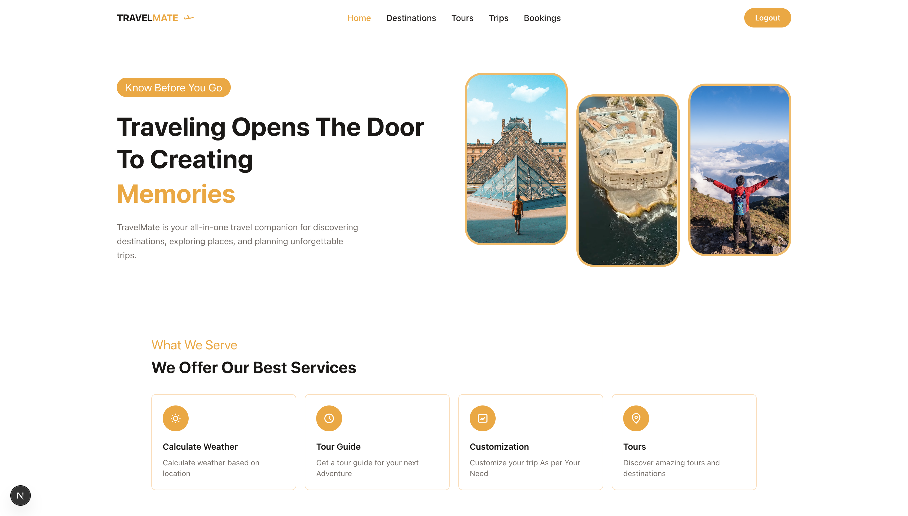
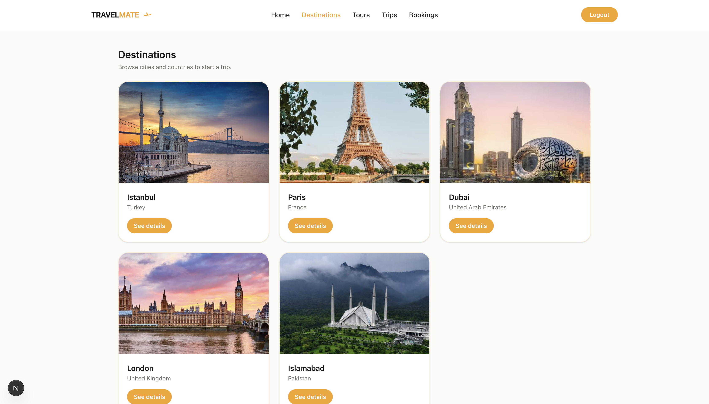
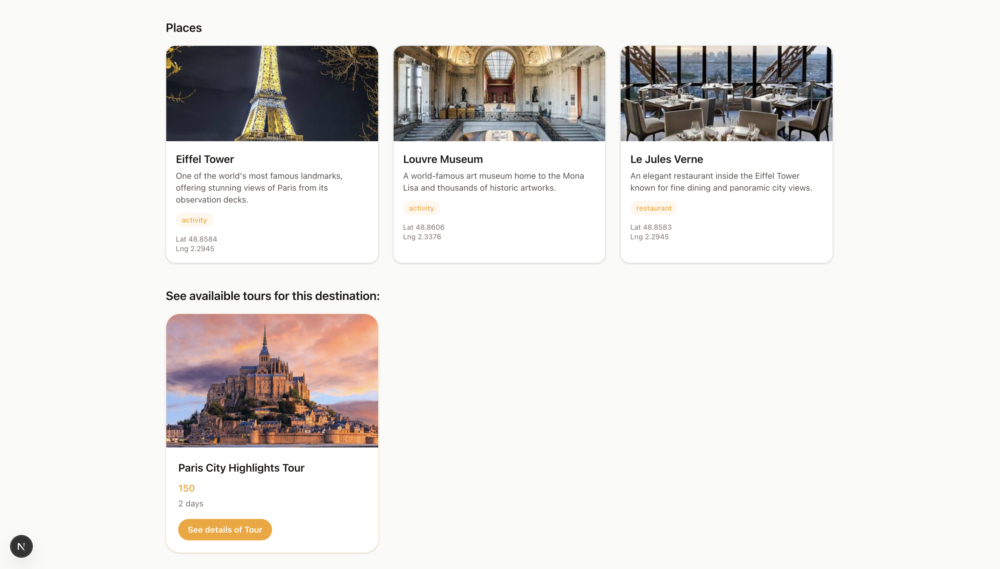
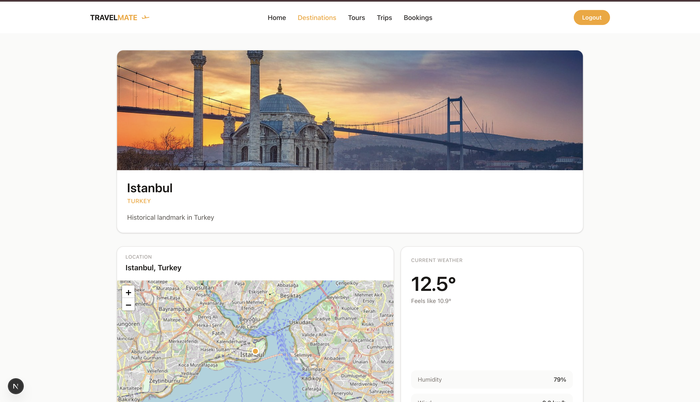
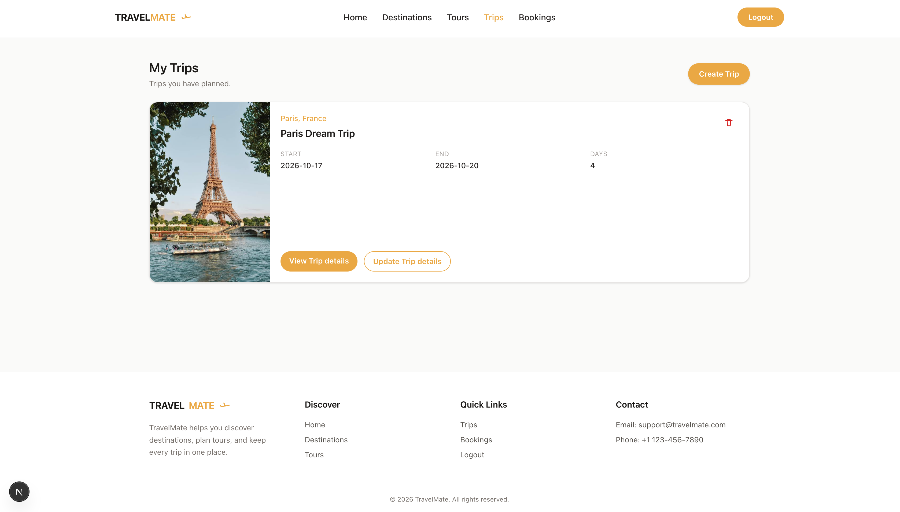
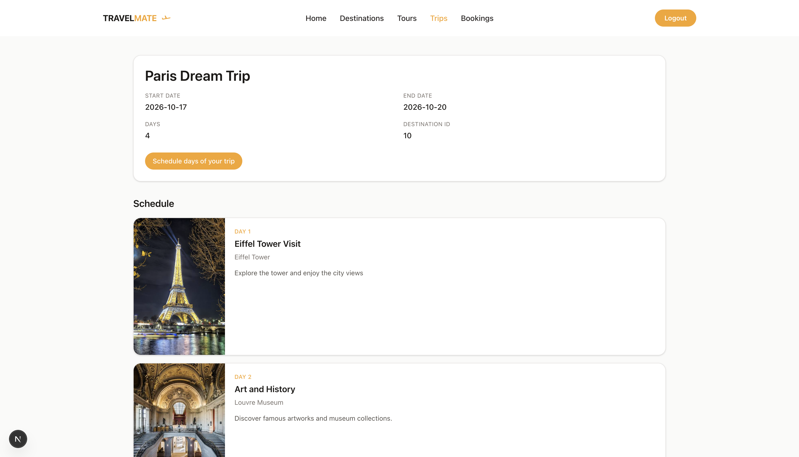
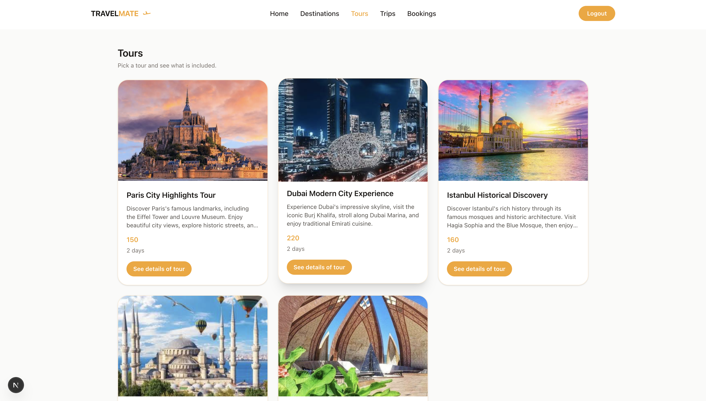
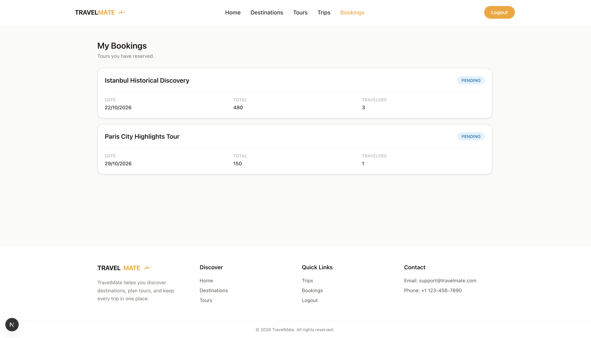
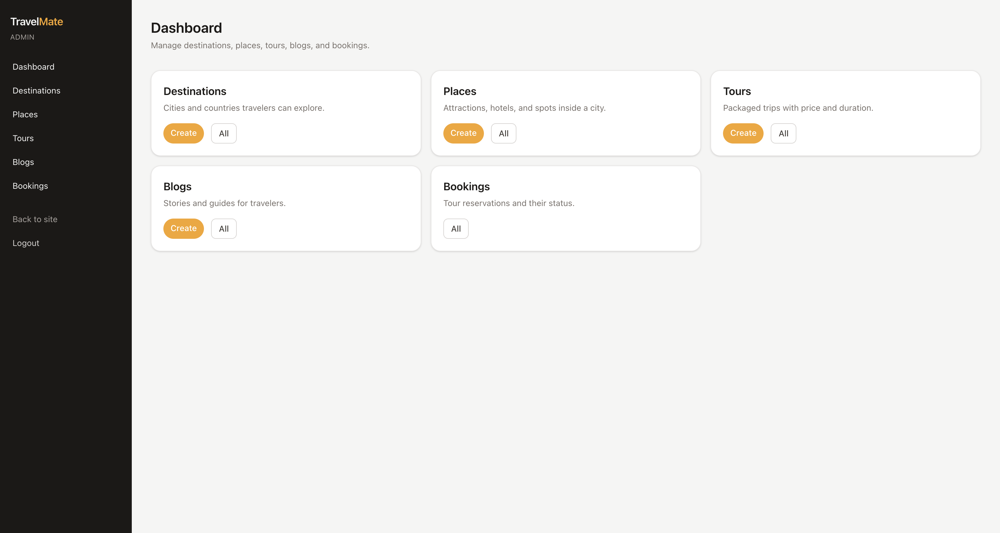

# 🌍 TravelMate

A travel planning platform to discover destinations, plan personalized trips, organize daily schedules, and manage trips easier. 🌍

<p align="center">
  
</p>

## About the Project 🚀

**TravelMate** is a full-stack travel planning platform built using **Next.js, Node.js, Express.js, PostgreSQL, and Prisma**. It brings destination discovery, place exploration, personalized itineraries, tour bookings, and useful travel information together in one place.

Users can explore destinations, discover attractions, restaurants, and hotels, view locations on interactive maps, check weather information, create personal trips, organize itineraries, and book travel experiences. Admins have a dedicated dashboard to manage destinations, places, tours, blogs, users, bookings, and reviews.

## ✨ Key Features

### 🌍 Destination Discovery

Explore destinations and browse detailed destination information.

<p align="center">
  
</p>

### 📍 Places & Attractions

Discover attractions, restaurants, hotels, and other useful places associated with each destination.

<p align="center">
  
</p>

### 🗺️ Interactive Maps & Travel Information

Explore places through interactive maps and view location details. External APIs provide travel-related information, including weather data, to help users learn more about their destinations.

<p align="center">
  
</p>

### 🧳 Personalized Trips & Itineraries

Create personal trips by selecting destinations, setting travel dates, and organizing activities by day. Users can manage itinerary items and keep their travel plans organized in one place.

<p align="center">
  
</p>

### 📆 Daily Trip Scheduling

Plan each day of a trip by assigning places and activities to specific days. Organize your travel schedule, view planned activities day by day, and keep your entire trip structured and easy to follow.

<p align="center">
  
</p>

### 🎟️ Tours & Experiences

Browse available tours, view their details, and explore experiences associated with destinations. Each tour includes pricing, duration, and related places.

<p align="center">
  
</p>

### 📅 Tour Bookings

Book tours by selecting a date and number of travelers. The platform calculates the total price, stores booking details, and allows users to view their bookings.

<p align="center">
  
</p>

### ⚙️ Admin Dashboard

A dedicated management area for administrators to manage users, destinations, places, tours, blogs, and bookings. The dashboard also provides an overview of platform activity.

<p align="center">
  
</p>

## 🛠️ Technologies Used

**Frontend**

- `Next.js`
- `React`
- `TypeScript`
- `Tailwind CSS`

**Backend**

- `Node.js`
- `Express.js`
- `REST API`
- `JWT Authentication`

**Database**

- `PostgreSQL`
- `Prisma ORM`

**External Integrations**

- `Maps API`
- `Weather API`

## 🚦 Running the Project

### 1. Clone the Repository

```bash
git clone https://github.com/areebamoosa/TravelMate.git
cd TravelMate
```

### 2. Install Dependencies

Install the frontend and backend dependencies separately.

```bash
cd frontend
npm install
```

```bash
cd ../backend
npm install
```

### 3. Configure Environment Variables

Create a `.env` file inside the `backend` directory.

```env
PORT=8080

DATABASE_URL="your_postgresql_connection_string"

JWT_SECRET="your_jwt_secret"

CLOUDINARY_CLOUD_NAME="your_cloudinary_cloud_name"
CLOUDINARY_API_KEY="your_cloudinary_api_key"
CLOUDINARY_API_SECRET="your_cloudinary_api_secret"
```

### 4. Set Up the Database

Make sure PostgreSQL is running and your database exists. Then, from the `backend` directory, run:

```bash
npx prisma migrate dev --name init
```

This creates and applies the initial database migration using your Prisma schema.

### 5. Start the Backend

From the `backend` directory, run:

```bash
npm run dev
```

The backend runs on `http://localhost:8080`.

### 6. Start the Frontend

Open a separate terminal and navigate to the frontend directory:

```bash
cd frontend
npm run dev
```
